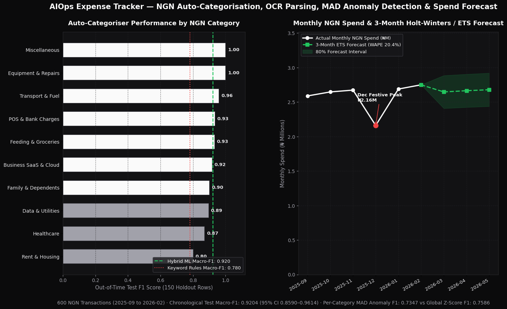
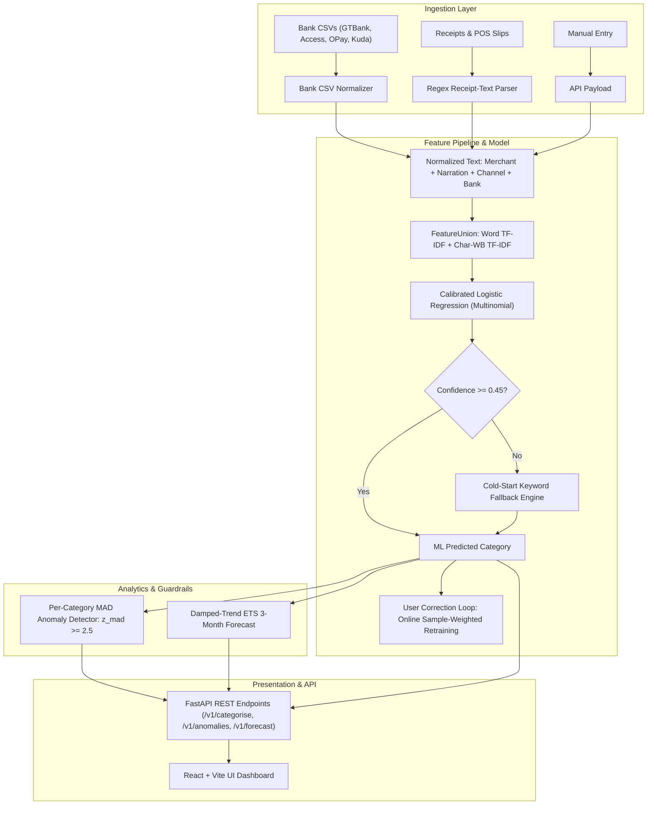

# AIOps Expense Tracker: NGN-First ML Categoriser, Receipt-Text Parser & Spend Forecaster

> **Note on Origin & Pedigree:** Started from the Code with Mosh Claude Code course starter; rebuilt and extended by Precious Ikebude with NGN bank CSV ingestion, TF-IDF + Logistic Regression auto-categorisation, receipt-text parsing, MAD z-score anomaly detection, and damped-trend exponential-smoothing spend forecasting.

[](https://github.com/ikebude/AIOps_Expense_Tracker/actions/workflows/ci.yml)
[](https://fastapi.tiangolo.com)
[](https://scikit-learn.org)
[](https://www.python.org)
[](LICENSE)

A personal and small-business expense tracker for Naira (NGN) bank data. Generic tools misclassify Nigerian narrations (NIP transfers, POS terminal text, USSD charges, stamp duty). This project pairs a Python ML and analytics API with a React + Vite dashboard.

> **All metrics below are on a synthetic, deterministically generated dataset (`ml/data.py`, seed 42). They show the pipeline works, not real-world accuracy.** Any "Demo data" in the dashboard is the same synthetic data and is opt-in (`DEMO_DATA=1`).

1. **NGN-tuned classifier**: word + char-wb TF-IDF with calibrated logistic regression, a keyword-rule fallback, and queued user-feedback retraining.
2. **Bank CSV and receipt-text ingestion**: CSV parsers for GTBank, Access Bank, OPay and Kuda (smoke-tested on one small sample each), plus a regex parser for pasted receipt text. There is no OCR: the parser takes text, not images. Use an external OCR tool first if you have photos.
3. **MAD anomaly detection**: per-category median absolute deviation scoring, so lumpy legitimate spends such as rent do not skew the baseline.
4. **Spend forecast**: level + damped-trend exponential smoothing with a fixed December x1.14 index (no estimated seasonal component), 3-month horizon.
5. **Dashboard**: expenses only (no income tracking, because the ML pipeline has no income model), NGN formatting, light/dark theme, mobile-first.

---

## Benchmark Metrics

Reproduce with `python -m ml.run_benchmark`; results land in `reports/metrics.json` (CI fails if the committed copy is stale).

| Evaluation Metric | Measured Result | Notes |
|:---|:---|:---|
| **Macro-F1 (chronological 75/25 holdout)** | **0.9204** | 95% bootstrap CI `[0.8590, 0.9614]`; keyword-rules baseline macro-F1 `0.7801` (+0.1403 absolute macro-F1) |
| **Accuracy** | **92.67%** | 95% CI `[0.8800, 0.9667]`; rules baseline `75.33%` |
| **Weighted-F1** | **0.9277** | |
| **Calibration (ECE)** | **0.1486** | Calibration is imperfect; treat confidences as rough |
| **5-fold CV macro-F1** | **0.9301 +/- 0.0231** | CV accuracy `93.00%` |
| **Rule fallback rate (test)** | **2.00%** | |
| **Receipt-text parsing** | **97.5%** field exact match (195/200) | 40 synthetic receipts; full-receipt match 92.5% (37/40); merchant 100%, date 100%, total 100%, VAT 92.5%, channel 95% |
| **Bank CSV smoke test** | **5/5 rows parsed** | 4 formats (GTBank, Access, OPay, Kuda), one tiny sample each |
| **Forecast holdout** | **WAPE 8.1%** (MAE N21,761.02) | vs naive last-value WAPE 11.22% (MAE N30,146.36); 2-month holdout; actuals exclude MAD-flagged spikes |

Anomaly detection (in-sample on synthetic data with 18 injected spikes, z threshold 2.5):

| Method | Precision | Recall | F1 | Flagged |
|:---|:---:|:---:|:---:|:---:|
| Per-category MAD | 0.9474 | 1.0000 | 0.9730 | 19 (18 true) |
| Global z-score baseline | 0.7857 | 0.6111 | 0.6875 | - |

Note: the dashboard API buckets months by calendar date while the benchmark uses the dataset's own `month` column (3 boundary rows differ), so the forecast on demo data in the UI can differ slightly from the 8.1% benchmark figure.

---

## Performance Visualisation



*Figure 1 (synthetic data): (left) per-category F1 of the classifier against the rules baseline; (right) monthly NGN spend with the 3-month damped-trend ETS forecast. The forecast has no drawn confidence band.*

---

## Category-Level Classification Breakdown

Evaluated on the strict chronological holdout split (150 test transactions):

| Category | Precision | Recall | F1-Score | Support |
|:---|:---:|:---:|:---:|:---:|
| **Equipment & Repairs** | 1.0000 | 1.0000 | **1.0000** | 10 |
| **Miscellaneous** | 1.0000 | 1.0000 | **1.0000** | 12 |
| **Transport & Fuel** | 0.9200 | 1.0000 | **0.9583** | 23 |
| **POS & Bank Charges** | 1.0000 | 0.8750 | **0.9333** | 16 |
| **Feeding & Groceries** | 0.9310 | 0.9310 | **0.9310** | 29 |
| **Business SaaS & Cloud**| 0.9167 | 0.9167 | **0.9167** | 12 |
| **Family & Dependents** | 1.0000 | 0.8182 | **0.9000** | 11 |
| **Data & Utilities** | 1.0000 | 0.8095 | **0.8947** | 21 |
| **Healthcare** | 0.7692 | 1.0000 | **0.8696** | 10 |
| **Rent & Housing** | 0.6667 | 1.0000 | **0.8000** | 6 |
| **Macro-F1** | | | **0.9204** | 150 |

---

## System Architecture



---

## API Specifications

Interactive docs at `/docs` once running. Request sizes are bounded (e.g. narration 500 chars, receipt text 10,000, CSV 1,000,000 characters and 5,000 parsed rows, 5,000 anomaly rows).

| Endpoint | Auth | Purpose |
|:---|:---|:---|
| `GET /health` | none | status, dataset rows, model ready, `demo_data`, `expenses_count` |
| `GET /v1/categories` | none | the 10 category names |
| `POST /v1/categorise` | none, rate-limited | category, confidence, source (`ml_tfidf_logreg` or `rule_fallback`) |
| `POST /v1/receipt/parse` | none, rate-limited | parse pasted receipt text to `{merchant, date, total_ngn, vat_ngn, payment_channel}` plus a suggested category |
| `POST /v1/anomalies` | none, rate-limited | MAD scoring against stored category baselines |
| `GET /v1/expenses?month=YYYY-MM&limit&offset` | none | stored expenses with anomaly flags |
| `GET /v1/summary?month=YYYY-MM` | none | month total, per-category totals, change vs previous month |
| `GET /v1/forecast?horizon_months=1..12` | none | spend forecast (history plus next months); 422 with fewer than 3 months of history |
| `POST /v1/expenses` | `X-API-Key` | add an expense (auto-categorised unless `category` is given); amounts stored as integer kobo |
| `POST /v1/csv/import` | `X-API-Key` | parse a bank CSV and label rows (does not store them) |
| `POST /v1/categorise/feedback` | `X-API-Key` | queue a correction (202); a background retrain is scheduled when `FEEDBACK_BATCH_SIZE` corrections are pending |
| `POST /v1/categorise/retrain` | `X-API-Key` | retrain now from queued corrections; builds a new model and swaps it in only on success |

**Auth model:** single-user. Write and import endpoints need the `EXPENSE_API_KEY` secret in an `X-API-Key` header. If it is not configured those endpoints return 503 (fail closed); a wrong key returns 401. Reads are open. This is not multi-user auth. Rate limits are in-process per client IP (`RATE_LIMIT_PER_MINUTE`, `FEEDBACK_RATE_LIMIT_PER_MINUTE`); behind a reverse proxy the client IP is the proxy, so rate-limit at the proxy as well. CORS allows only `ALLOWED_ORIGINS`. All variables are listed in `.env.example`.

The per-category `ci80_*` fields in the forecast are +/-1.28 sigma of in-sample residuals, not a calibrated prediction interval.

---

## Quickstart & Execution

### 1. API
```bash
cd AIOps_Expense_Tracker
python -m venv .venv && source .venv/bin/activate
pip install -r requirements-dev.txt
cp .env.example .env            # then set EXPENSE_API_KEY=some-long-random-string
set -a; . ./.env; set +a
python -m ml.run_benchmark      # regenerate data, reports/metrics.json, img/hero.png
pytest -q
DEMO_DATA=1 uvicorn ml.api:app --reload --port 8000   # DEMO_DATA=1 loads the synthetic rows
```
The model (`models/categoriser.joblib`) is not committed: it is built on first start and saved. Joblib files are pickles, so only load them from a path you trust.

### 2. Frontend
```bash
npm ci
npm run dev        # http://localhost:5173
npm test           # vitest + Testing Library
npm run lint && npm run build
```
Set `VITE_API_BASE` (default `http://localhost:8000`) at build time. The dashboard has an "API key" field for adding expenses; the key is held in memory only and is never bundled.

### 3. Docker
`Dockerfile.api`, `Dockerfile.web` and `docker-compose.yml` are provided (`cp .env.example .env && docker compose up --build`; UI on :8080, API on :8000). `docker compose config` validates, but the images were not built in this environment (no Docker daemon).

---

## Repository Structure

```
AIOps_Expense_Tracker/
├── .github/workflows/ci.yml       # Python (benchmark freshness + pytest) and frontend (lint, test, build, audit) jobs
├── data/ngn_expenses_labelled.csv # 600-row synthetic NGN dataset
├── img/hero.png                   # 2-panel evaluation chart
├── ml/                            # api, config, security, store, categoriser, analytics, ingestion, data, run_benchmark
├── models/.gitkeep                # model built at startup, not committed
├── reports/metrics.json           # benchmark results
├── src/                           # React + Vite dashboard (components, lib, tests)
├── tests/                         # pytest: 30 tests
├── Dockerfile.api, Dockerfile.web, docker-compose.yml, deploy/nginx.conf
├── requirements.txt, requirements-dev.txt, .env.example
└── LICENSE
```

Tests: 30 pytest tests and 29 vitest tests pass.

---

## Author & License

Built and maintained by **Precious Ikebude** ([GitHub: @ikebude](https://github.com/ikebude)).  
Released under the [MIT License](LICENSE).
